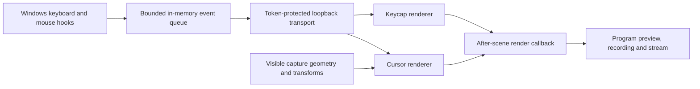

# Architecture

InputFX is a Windows x64 DLL loaded by OBS. It has two private Browser Source renderers, neither of which is inserted into a scene.

The before-render callback records the canvas dimensions. The after-render callback draws the effects after the scene, so opaque captures cannot cover them.

Cursor mapping finds a visible Display Capture or Window Capture, resolves its physical monitor or window rectangle, and maps the pointer through source crops and scene-item transforms. Window captures are checked against the window actually under the pointer. Nested scenes and groups are traversed with a bounded depth.

The UI thread owns settings changes and cursor mapping. A dedicated input thread owns the Windows hooks. The transport thread drains a bounded event queue and serves only loopback clients with the current session token. No character history is stored on disk.

On OBS exit, the plugin removes render callbacks, releases both renderers, unregisters its hotkey, stops the input and transport threads, and saves settings before OBS shuts down its Browser component.

The minimal OBS C ABI declarations are in `src/obs-api.hpp`. They were checked against OBS Studio 32.2.2. The module uses runtime symbol resolution so missing APIs cause a load failure rather than an unresolved import.
